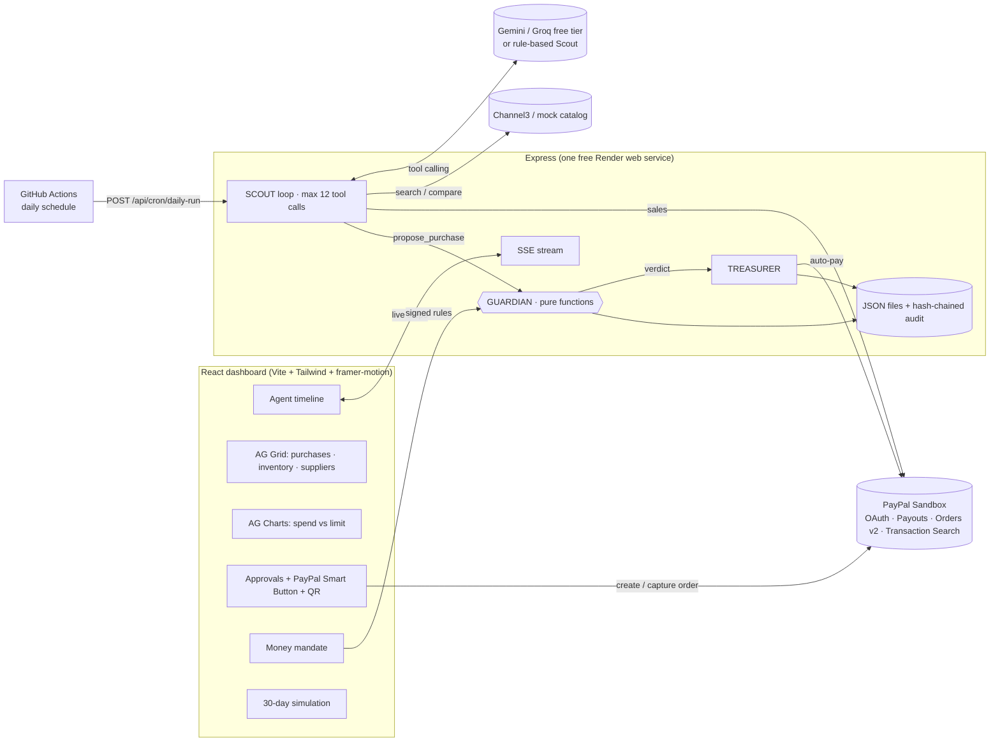
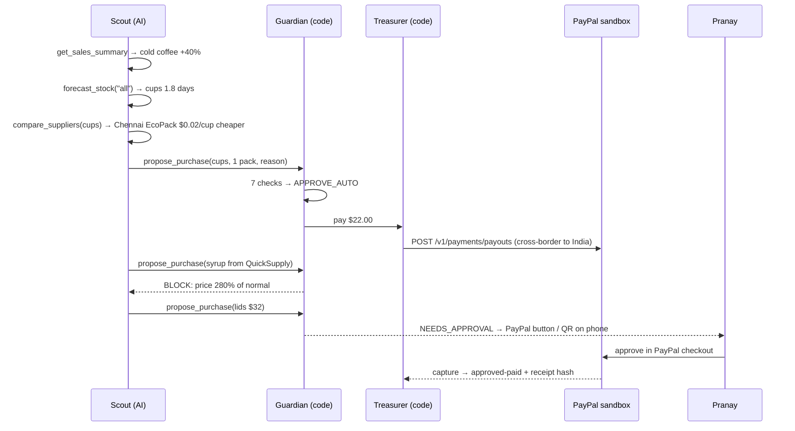

# Restock: the trust layer for agentic commerce

> **The AI decides. The code guards the money. PayPal moves it.**

 <!-- TODO: add a short GIF of the shield moment -->

**▶ Live demo:** _TODO: https://your-service.onrender.com_ · **🎬 Video (3 min):** _TODO: link_

**The problem.** Small business owners lose hours every week reordering supplies. When they forget, they run out of stock and lose sales. When they rush, they overpay. AI agents could do this job, but no owner will hand an AI their PayPal account. **Capability isn't the blocker. Trust is.**

**The solution.** Restock is an AI purchasing agent for small businesses, built as three roles. Only one of them is AI:
- 🟣 **Scout (AI)** reads sales, forecasts stock, compares local and international suppliers, and *proposes* purchases with a plain-English reason.
- 🟠 **Guardian (code, never AI)** checks every proposal against the owner's **signed money mandate**. Its verdict is final.
- 🟢 **Treasurer (code + PayPal)** protects the cash buffer, pays suppliers worldwide through PayPal, and writes hash-stamped receipts.

The AI **cannot** call PayPal. The only path to money is `propose_purchase → Guardian → Treasurer`.

### How PayPal is used (sandbox)
| PayPal API | What Restock does with it |
|---|---|
| **OAuth 2.0** `POST /v1/oauth2/token` | Server-side client-credentials login; token cached until expiry. The secret never reaches the browser. |
| **Payouts** `POST /v1/payments/payouts` | **Agentic auto-pay**: the agent pays a supplier with no human click, **cross-border** to the India-based suppliers. Idempotent (`PayPal-Request-Id`). |
| **Payouts** `GET /v1/payments/payouts/{batch_id}` | Re-checks the batch and item status, payout item ID and transaction ID after sending; written to the audit chain. |
| **Orders v2** `POST /v2/checkout/orders` | Over-limit purchases become a checkout order for the owner to approve. |
| **Orders v2** `POST /v2/checkout/orders/{id}/capture` | Money moves only when the owner approves; the capture ID and status are recorded. |
| **JS SDK Smart Buttons** | The approval button on the dashboard and on the phone page (QR code). |
| **Transaction Search** `GET /v1/reporting/transactions` *(optional)* | With `USE_PAYPAL_SALES=true`, Scout reads the café's real sandbox sales: **PayPal data in → AI decides → PayPal money out.** |
| **Webhooks** `POST /v1/notifications/verify-webhook-signature` *(optional)* | Verifies incoming payout and capture events. |

Every PayPal ID and status appears in the **Decision Trace** and on the **receipt**, with a pointer to the sandbox dashboard.

### How AI is used
- **Scout tool calling** (Gemini 2.5 Flash or Groq Llama 3.3, both free tiers). Tools: `get_sales_summary`, `get_inventory`, `forecast_stock`, `search_products`, `compare_suppliers`, `get_cash_position`, `propose_purchase`, `log_decision`. All maths is done in code; the AI reasons and explains.
- **Money mandate parsing:** the owner's plain-English rules become JSON, validated by **zod**.
- **Weekly briefing**, and **Ask Restock** (Q&A over purchases, audit and cash, with voice input).
- **Never breaks:** if the AI is rate-limited, the timeline says *"AI busy, using backup logic"*, and a rule-based Scout finishes the run **under the same Guardian**.

> **Honest note:** payments run in the **PayPal sandbox** (no real money). Sales are **seeded demo data** unless `USE_PAYPAL_SALES=true` pulls them from PayPal; the UI always shows "Sales source: …". Product search uses a **mock catalog** until Channel3 is connected. Live/Mock pills show the state of every external service.

---

## Architecture





**What runs where:**
- **Render (free web service):** the API, the SSE stream, the React app, Guardian, Treasurer and every PayPal call.
- **GitHub Actions (free):** [daily-agent.yml](.github/workflows/daily-agent.yml) triggers the daily agent check. Render cron jobs are a paid feature; the equivalent definition is commented out in [render.yaml](render.yaml).
- **Your browser:** the dashboard only. It never sees the PayPal secret or the AI keys.

## Trust and safety design

**Guardian's 7 checks** (pure, deterministic and unit-tested):
1. The mandate is active and signed.
2. The category is approved.
3. The total is within the per-order limit.
4. Week-to-date spend plus this total is within the weekly budget.
5. The unit price is within the allowed deviation from the 30-day average.
6. A new supplier needs owner approval.
7. Balance minus total stays at or above the minimum cash buffer.

**Verdicts:**
- **APPROVE_AUTO:** all checks pass and the total is under the auto-approve limit.
- **NEEDS_APPROVAL:** all checks pass, but the amount or a new supplier needs the owner.
- **DELAY:** *only* the cash check fails, and an incoming settlement will cover it.
- **BLOCK:** anything else.

**Other safeguards:**
- **Signed money mandate:** plain English → zod-validated rules → signed, versioned, SHA-256 hashed and revocable. Guardian enforces exactly this.
- **Kill switch:** refuses new runs, stops a run in progress, holds auto-payments, and is logged.
- **Hash-chained audit ledger:** `hash = SHA-256(prevHash + entry)`. **Verify integrity** re-walks the chain and pinpoints any edited or deleted entry. Full PayPal response summaries are written into the chain.
- **Offers come from the catalog only:** the AI can't invent a price or a supplier.
- **Rate limits** on the agent, Ask, mandate parsing and Demo mode protect the free AI quota and the sandbox while the demo is public.
- **Approval re-checks:** Guardian runs again when the owner approves; the owner can approve over-limit amounts, never a BLOCK.

## Impact KPIs

| KPI | Live dashboard | 30-day simulation* |
|---|---|---|
| Stockouts prevented | from real purchases | **3** |
| Lost sales avoided | estimate ($60 per stockout day) | **$180** |
| Money saved vs average price | from real purchases | **$125** |
| Cross-border savings vs local | from real purchases | **$250** |
| Owner hours saved per week | estimate | **2.9 h** |
| Purchases handled automatically | from real purchases | **55%** |
| Risky purchases blocked | from real purchases | **3** |
| Rule violations | **0** (must always be 0) | **0** |
| Days the cash buffer was kept | from cash history | **30 / 30** |

\* **Simulated on seeded demo data** with the default mandate, using the real Guardian code (no AI calls per simulated day). Assumptions are editable on the Simulation page.

## Sponsor tools

### AG Grid (Community)
**Why AG Grid:** a purchasing agent is only trustworthy if the owner can audit it quickly. The grids are where Pranay checks the agent's work.
- **Purchases grid:**
  - A **pinned totals row** (total paid, total saved) follows every filter. "What did the agent spend with Chennai EcoPack this week?" takes one filter.
  - **Status badges**, **flag + Intl cells**, and **PayPal ID tooltips**. Every row opens its **Decision Trace**: the AI's reason, Guardian's checks, and the PayPal IDs.
  - **Quick search**, column filters (text, number, date), and **CSV export** for the accountant.
- **Inventory grid:** live forecast, **days-left badges** (red under 3 days), and an inline **SVG sparkline renderer** for 14-day usage. You can see *why* the agent wants to buy.
- **Suppliers grid:** a **trust-score bar renderer** and **price-trend sparklines**. This shows why a new supplier at 280% of normal is suspicious.
- **Every grid:** column layout (order, width, sort) is **saved in localStorage** and has a reset button. One theme built from CSS variables switches light and dark instantly. Community features only.

### AG Charts (Community)
Daily spend and savings bars, a rolling 7-day spend line, and a dashed weekly-limit line, all on one dollar axis. Includes a table-view toggle. The palette was checked for color-blind separation in both themes.

### Channel3
All product search goes through [server/services/channel3.js](server/services/channel3.js) (`searchProducts`, `offersForSku`). **Status: mock catalog.** The real client is a clearly marked `TODO(Channel3)`, to be filled in from the official docs (endpoints were not guessed). Then set `USE_MOCK_CHANNEL3=false`, `CHANNEL3_API_KEY` and `CHANNEL3_API_BASE`. The Decision Trace labels the source of each comparison ("Channel3" or "mock catalog"), and API errors fall back to the mock.

### Render
- One free web service serves the API and the built React app ([render.yaml](render.yaml)). Health check: `/api/health`.
- `SEED_ON_START=true` gives fresh demo data on every boot. A fresh visitor sees a prominent **Run Demo** button.
- A friendly **"Waking up the server"** screen covers free-tier cold starts.
- SSE sends a 20-second heartbeat through Render's proxy.
- The daily agent check is triggered by GitHub Actions (see *What runs where*).

### APIMatic
_TODO (Pranay): describe how the APIMatic PayPal Context Plugin was used during the PayPal integration, with a screenshot. Only keep this section if it was actually used._

## Setup (Windows PowerShell)

Requires **Node.js 20.12+** (`node -v`).

```powershell
cd restock
npm run install-all
Copy-Item .env.example .env   # add keys (everything also works on mocks)
npm run seed
npm test                      # 43 Vitest tests
npm run dev                   # dashboard http://localhost:5173 (API on :3456)
```

Production-style (what Render runs): `npm run build`, then `npm start`, then open http://localhost:3456.
Other scripts: `npm run lint` (ESLint) and `npm run format` (Prettier).

**Live keys** (every key is described in [.env.example](.env.example)):
- `GEMINI_API_KEY` or `GROQ_API_KEY`
- `PAYPAL_CLIENT_ID` and `PAYPAL_CLIENT_SECRET`, with **Payouts** (and optionally **Transaction search**) ticked in the sandbox app's features
- One sandbox personal account per supplier group: `SUPPLIER_EMAIL_LOCAL` (US), `SUPPLIER_EMAIL_COORG` (India), `SUPPLIER_EMAIL_CHENNAI` (India)

### Deploy to Render
1. Push this folder to a **public GitHub repo**. `.env` and the data files are git-ignored.
2. In Render, choose **New → Blueprint** and pick the repo. Fill in the secrets it asks for, and set `PUBLIC_URL` to the service URL.
3. In the GitHub repo, open **Settings → Secrets → Actions** and add `RESTOCK_URL` and `CRON_SECRET` (copy the value Render generated). Then run *Daily agent check* once by hand.
4. *Optional:* keep [keep-warm.yml](.github/workflows/keep-warm.yml) to avoid cold starts during judging (1–15 December). Read its budget note first.

## Tests

`npm test` runs Vitest (43 tests):
- [guardian.test.js](server/tests/guardian.test.js): every rule and every verdict, including the 280% trap and the cash-delay date maths.
- [simulate.test.js](server/tests/simulate.test.js): deterministic output, zero violations, traps blocked, mandate parsing and validation, KPIs.
- [ledger.test.js](server/tests/ledger.test.js): chain linking, plus tamper, deletion and forgery detection.
- [hardening.test.js](server/tests/hardening.test.js): per-supplier payout routing, the PayPal transactions → sales mapping, and rate limiting.

## API

```
GET  /api/config /api/health /api/status /api/kpis
GET  /api/sales /api/inventory /api/suppliers /api/cash   POST /api/sales/sync
GET  /api/mandate /api/mandate/history     POST /api/mandate/parse /sign /revoke
POST /api/agent/run /pause /resume         GET  /api/agent/stream (SSE)
POST /api/agent/ask                        GET  /api/briefing
GET  /api/purchases /api/purchases/:id     POST /api/purchases/:id/reject /retry
POST /api/paypal/orders /api/paypal/orders/:id/capture /api/paypal/webhook
GET  /api/audit /api/audit/verify          POST /api/simulate
POST /api/demo/reset /api/demo/run /api/cash/settle /api/cron/daily-run
```

Errors always have the shape `{ "error": { "code", "message", "details?" } }`.

## Limitations (honest)

- **PayPal sandbox only.** No real money moves.
- **Cash balance:** simulated from seeded data, because reading a live PayPal balance needs extra permissions.
- **Sales:** seeded by default. PayPal sales input needs Transaction Search enabled, and new sandbox transactions can take ~3 hours to appear.
- **Suppliers and deliveries:** suppliers, catalog prices and purchase history are seeded. Deliveries are simulated (stock arrives when paid).
- **Demo mode** uses a **scripted** Scout so the story is identical every time. **Run agent** uses the live AI. Guardian and PayPal are the same in both.
- **Channel3:** uses the mock catalog until the TODO is filled in.
- **Storage:** data lives in JSON files on one instance and resets when Render restarts. All visitors share one demo café, so one visitor's Demo run resets what another sees.
- **Free AI tiers rate-limit.** Restock retries once, then the rule-based Scout takes over (and says so).
- **QR approval** needs a URL your phone can reach (`PUBLIC_URL`).

## License and third-party assets

Restock is released under the [MIT License](LICENSE).

| Asset | License |
|---|---|
| Twemoji Country Flags font (via `country-flag-emoji-polyfill`): flag art © Twitter/X, [Twemoji](https://github.com/twitter/twemoji) | Art **CC-BY 4.0** (see [license file](client/public/fonts/LICENSE-TwemojiCountryFlags.md)); code MIT |
| Inter font (`@fontsource/inter`) | SIL OFL 1.1 |
| Lucide icons (`lucide-react`) | ISC |
| AG Grid Community, AG Charts Community | MIT |
| React, Vite, Tailwind CSS, framer-motion, qrcode, Express, zod | MIT |
| canvas-confetti, node-cron | ISC |
| `@google/genai` | Apache 2.0 |

PayPal and the PayPal logo are trademarks of PayPal, Inc. They're used only to show the PayPal integration, through PayPal's own JS SDK buttons. Restock isn't affiliated with or endorsed by PayPal.
