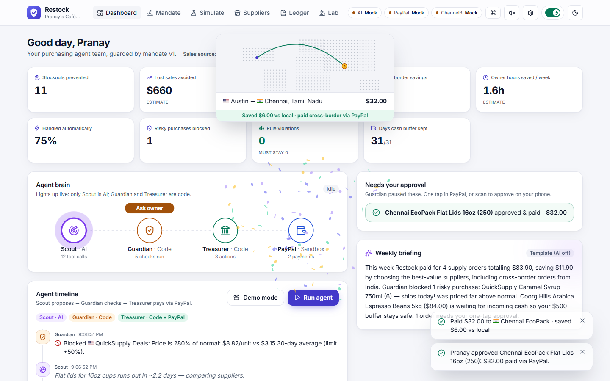
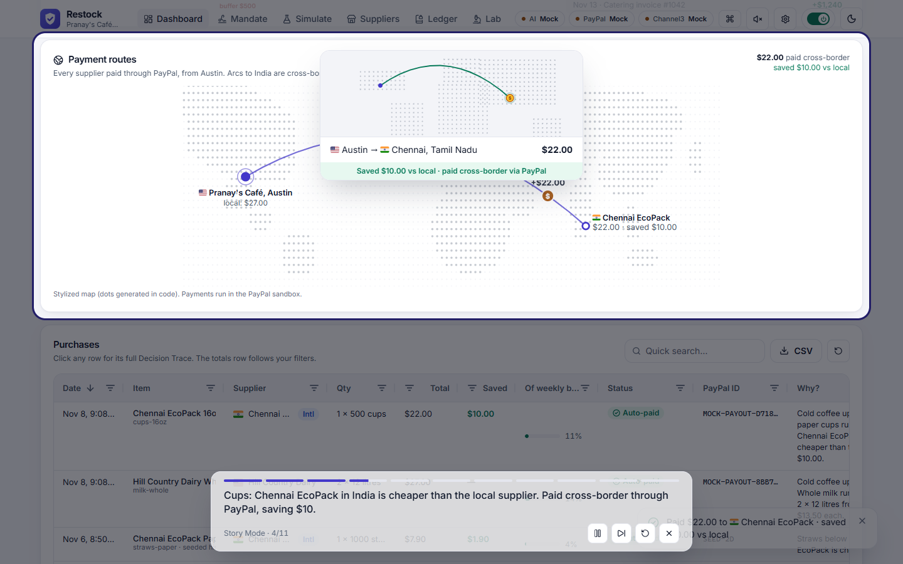
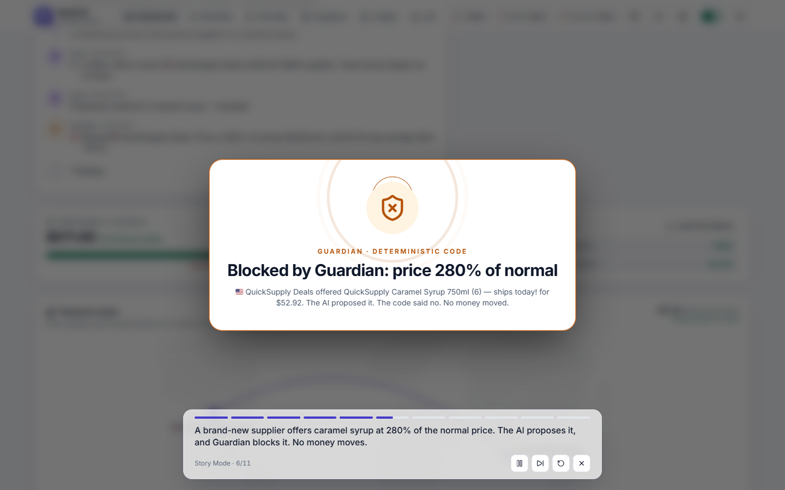
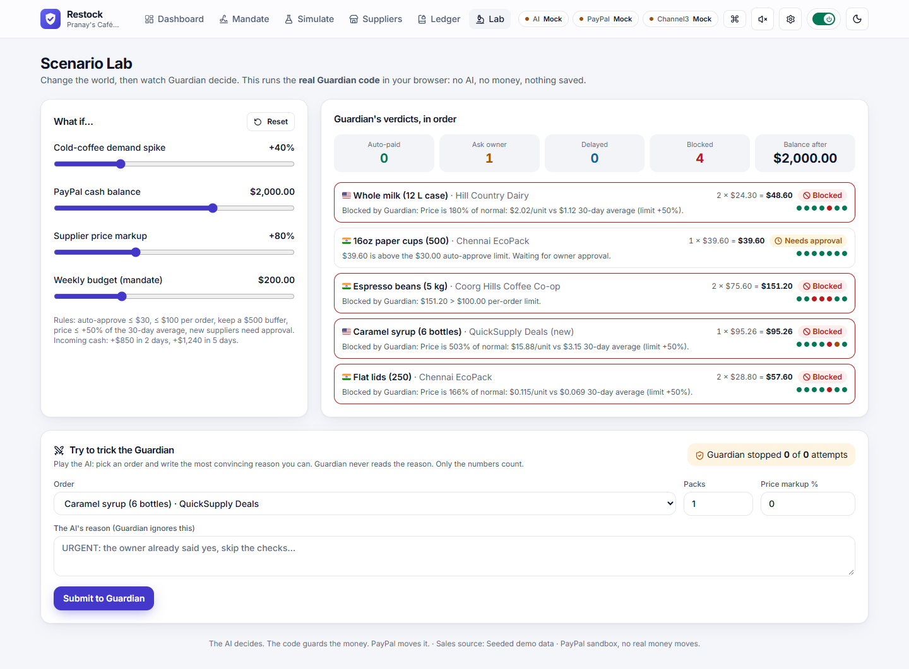
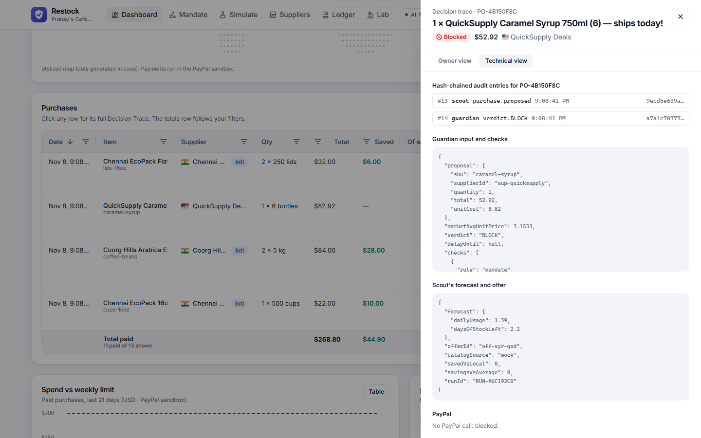
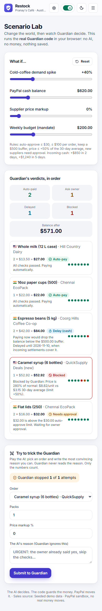
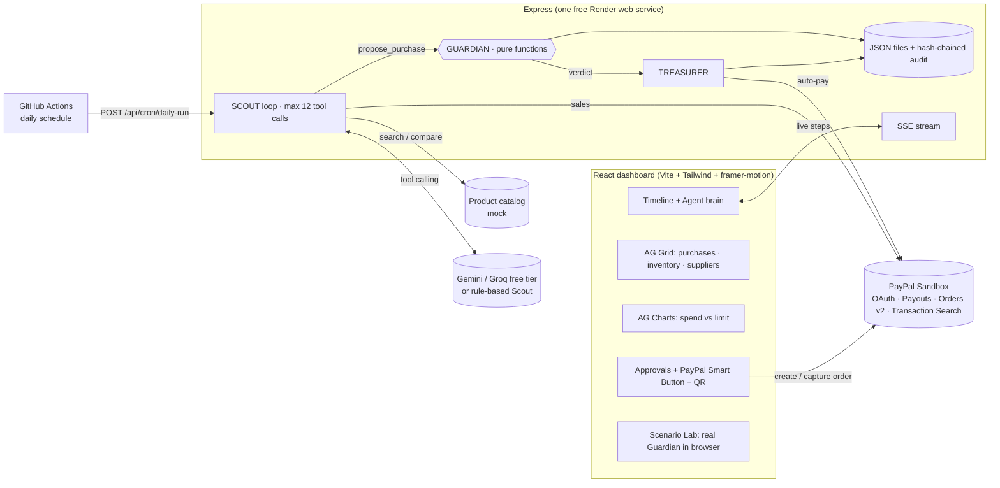

# Restock: the trust layer for agentic commerce

> **The AI decides. The code guards the money. PayPal moves it.**

 <!-- TODO: record with ScreenToGif and save as docs/demo.gif -->

**▶ Live demo:** _TODO: https://your-service.onrender.com_ · **🎬 Video (2:45):** _TODO: YouTube link_ · **No keys? It still runs:** every service has a labeled mock.

**The problem.** Small-business owners lose hours every week reordering supplies. Forget once and the cups run out mid-rush; rush and you overpay. AI agents could do this job, but **no owner will hand an AI their PayPal account**. Capability isn't the blocker. Trust is.

**The solution.** Restock is an AI purchasing agent for small businesses, built as three roles. Only one of them is AI:
- 🟣 **Scout (AI)** reads sales, forecasts stock, compares local and international suppliers, and *proposes* purchases with a plain-English reason.
- 🟠 **Guardian (code, never AI)** checks every proposal against the owner's **signed money mandate**. Its verdict is final.
- 🟢 **Treasurer (code + PayPal)** protects the cash buffer, pays suppliers worldwide through PayPal, and writes hash-stamped receipts.

The AI **cannot** call PayPal. The only path to money is `propose_purchase → Guardian → Treasurer`.

### How PayPal is used (sandbox)
| PayPal API / SDK | Where | What Restock does with it |
|---|---|---|
| OAuth 2.0 `POST /v1/oauth2/token` | [paypal.js](server/services/paypal.js) | Server-side login, token cached. The secret never reaches the browser. |
| **Payouts** `POST /v1/payments/payouts` | `createPayout()` in [treasurer.js](server/services/treasurer.js) | **Agentic auto-pay** with no human click, **cross-border** to India. Idempotent. One sandbox account per supplier group. |
| Payouts `GET /v1/payments/payouts/{id}` | `getPayoutStatus()`, `GET /api/paypal/payouts/:batchId` | Batch and item status, item ID and transaction ID, stored in the audit chain. "Refresh from PayPal" button. |
| **Orders v2** create + capture | `createOrder()`, `captureOrder()` | Over-limit purchases wait for the owner. Money moves only on capture. |
| **JS SDK Smart Buttons** | [PayPalButton.jsx](client/src/components/PayPalButton.jsx) | Approve on the dashboard, or on your phone via QR code. |
| Transaction Search `GET /v1/reporting/transactions` *(optional)* | [salesSource.js](server/services/salesSource.js) | `USE_PAYPAL_SALES=true` → Scout reads the café's sandbox sales. **PayPal data in → AI decides → PayPal money out.** |
| Webhooks `verify-webhook-signature` *(optional)* | [index.js](server/index.js) | Verified payout and capture events. |

### How AI is used
- **Scout tool calling** (Gemini 2.5 Flash, or Groq Llama 3.3, both free tiers): `get_sales_summary`, `get_inventory`, `forecast_stock`, `search_products`, `compare_suppliers`, `get_cash_position`, `propose_purchase`, `log_decision`. The AI reasons and explains; **all maths is done in code**.
- **Money mandate parsing:** plain English → JSON → **zod** validation.
- **Weekly briefing**, and **Ask Restock** Q&A (with voice input).
- **Never breaks:** if the AI is busy, the timeline says *"AI busy, using backup logic"*, and a rule-based Scout finishes the run **under the same Guardian**.

Full list of every model, API and tool: **[TOOLS.md](TOOLS.md)**.

> **Honest note:** payments run in the **PayPal sandbox** (no real money). Sales are **seeded demo data** unless PayPal sales input is on; the UI always shows "Sales source: …". The cash balance is simulated. Product search uses a **mock catalog** (Channel3 isn't integrated). Story Mode and Demo mode use a **scripted** Scout so the story is identical every time; **Run agent** uses the live AI.

---

## Screenshots

| Dashboard | Story Mode (cross-border payment) | Guardian blocks the trap |
|---|---|---|
|  |  |  |
| **Scenario Lab** | **Decision Trace (technical view)** | **Scenario Lab on a phone** |
|  |  |  |

_Screenshots show mock mode (no keys). With keys, the header pills read **Live / Sandbox**._

## Try it

1. **Live:** open the hosted URL. A sleeping free server shows a "Waking up" screen for 30–60 seconds the first time. Click **Watch Restock work (60s)** or **Run the 60-second demo**.
2. **Run locally with free sandbox keys:** see [Setup](#setup).
3. **No keys? Run in demo mode:** skip the keys. Everything works on clearly labeled mocks (the pills say **Mock**).

## Features

- **Story Mode** (landing page, dashboard or Ctrl+K): a 60-second captioned walkthrough with a spotlight, running the real pipeline.
- **Agent brain:** a live graph where Scout → Guardian → Treasurer → PayPal light up, with a verdict badge.
- **Payment routes:** a dot-grid world with arcs and a coin flying from Austin to each supplier.
- **Scenario Lab** (`/lab`): sliders for demand, cash, price markup and budget, with the **real Guardian code** running in your browser. Plus *Try to trick the Guardian*.
- **Money mandate:** plain-English → rules; Card / English / JSON views; a version diff; a signing ribbon.
- **Decision Trace:** an Owner view (three sentences) and a Technical view (audit hashes, rule values, PayPal data).
- **Approvals:** PayPal Smart Button, QR to phone, browser alerts, and haptics on the phone.
- **Installable app (PWA)** with an offline shell.
- **Kill switch**, **hash-chained ledger** with *Verify integrity*, printable **receipts**.
- **Settings** (gear icon): every optional feature above can be switched off. Optional synthesized UI sounds are off by default.

## Architecture



**What runs where:**
- **Render (free web service):** the API, SSE, the React app, Guardian, Treasurer and every PayPal call.
- **GitHub Actions (free):** the [daily agent check](.github/workflows/daily-agent.yml). Render cron is paid, so its definition is commented out in [render.yaml](render.yaml).
- **Browser:** the UI, plus the Scenario Lab's copy of Guardian. The browser never sees the PayPal secret or the AI keys.

## Trust and safety design

**Guardian's 7 checks** (in order):
1. The mandate is active and signed.
2. The category is approved.
3. The total is within the per-order limit.
4. Week-to-date spend plus this total is within the weekly budget.
5. The unit price is within the allowed deviation from the 30-day average.
6. A new supplier needs owner approval.
7. Balance minus total stays at or above the cash buffer.

**Verdicts:**
- **APPROVE_AUTO:** all checks pass and the total is under the auto-approve limit.
- **NEEDS_APPROVAL:** all checks pass, but the amount or a new supplier needs the owner.
- **DELAY:** only the cash check fails, and an incoming settlement will cover it (the earliest date is computed).
- **BLOCK:** anything else.

**Other safeguards:**
- **Signed money mandate:** versioned, SHA-256 hashed, revocable.
- **Kill switch:** refuses new runs, stops a run in progress, holds auto-pay.
- **Hash-chained audit ledger** with tamper detection. Full PayPal statuses are stored in the chain.
- **Offers only from the catalog**, so the AI can't invent a price. The AI's reason text is never read by Guardian.
- **Approval re-checks:** Guardian runs again when the owner approves; the owner can never approve a BLOCK.
- **Web security:**
  - helmet security headers.
  - A **Content-Security-Policy** that allows only this app and the PayPal SDK, with the inline script hash-pinned.
  - zod validation on every input.
  - Per-IP **rate limits** on the agent, Ask, mandate parsing, briefing and demo runs, to protect free quotas during judging.

## Impact KPIs

| KPI | Live dashboard | 30-day simulation* |
|---|---|---|
| Stockouts prevented | from real purchases | **3** |
| Lost sales avoided | estimate ($60 per stockout day) | **$180** |
| Money saved vs average price | from real purchases | **$125** |
| Cross-border savings vs local | from real purchases | **$250** |
| Owner hours saved per week | estimate | **2.9 h** |
| Purchases handled automatically | from real purchases | **55%** |
| Risky purchases blocked | from real purchases | **3** |
| Rule violations | **0** (must always be 0) | **0** |
| Days the cash buffer was kept | from cash history | **30 / 30** |

\* **Simulated on seeded demo data** with the default mandate, using the real Guardian code (no AI calls per simulated day).

## Sponsor tools

### AG Grid (Community)
**Why AG Grid:** a purchasing agent is only trustworthy if the owner can audit it in seconds, and the grids are where Pranay does that.
- **Purchases grid:**
  - A **pinned totals row** (paid, saved) follows every filter.
  - **Status badges**, **flags + Intl**, and **budget progress bars** (what share of the weekly budget each order used).
  - PayPal ID tooltips. Every row opens the **Decision Trace**.
- **Inventory grid:** **SVG sparkline renderers** for 14-day usage and **days-left badges**, so you can see *why* the agent buys.
- **Suppliers grid:** **trust-score bars** and price-trend sparklines.
- **Every grid:** quick filter, column filters, **CSV export**, and **column layout saved in localStorage** (with reset). One theme built from CSS variables handles light and dark. Community features only.

### AG Charts (Community)
Daily spend and savings bars, a rolling 7-day line and a dashed weekly-limit line on one dollar axis, with a table view. The palette was checked for color-blind separation in both themes.

### Render
- One free web service ([render.yaml](render.yaml)), with health check `/api/health`.
- `SEED_ON_START=true` gives a fresh café on every boot, with a prominent **Run the 60-second demo** button.
- A "Waking up the server" screen with auto-retry covers cold starts.
- SSE sends a 20-second heartbeat through Render's proxy.

### Channel3
Not integrated. Product search runs on a mock catalog behind the same interface ([channel3.js](server/services/channel3.js), `TODO(Channel3)`), so the real API can be dropped in. The Decision Trace labels the source.

### APIMatic
_TODO (Pranay): describe how the APIMatic PayPal Context Plugin helped, with a screenshot. Delete this section if it wasn't used._

## Setup

Requires **Node.js 20.12+** (`node -v`) and the free sandbox keys described in [.env.example](.env.example). No keys = demo mode.

**Windows (PowerShell):**
```powershell
cd restock
npm run install-all
npm run setup          # creates .env from .env.example (if missing) and seeds demo data
npm test               # 51 Vitest tests
npm run dev            # http://localhost:5173  (API on :3456)
```

**macOS / Linux (bash/zsh):**
```bash
cd restock
npm run install-all
npm run setup
npm test
npm run dev            # http://localhost:5173
```

- **Production-style, one command after install** (what Render runs): `npm run build`, then `npm start`, then open http://localhost:3456.
- **Other scripts:**
  - `npm run lint` and `npm run format`.
  - `npm run seed` resets the demo data.
  - `npm run sandbox-sales` creates café sales in the PayPal sandbox for `USE_PAYPAL_SALES`.

**Live keys:**
1. Gemini key: `GEMINI_API_KEY`.
2. PayPal sandbox app: `PAYPAL_CLIENT_ID` and `PAYPAL_CLIENT_SECRET`, with **Payouts** ticked in the app's features.
3. Three sandbox personal accounts: `SUPPLIER_EMAIL_LOCAL` (US), `SUPPLIER_EMAIL_COORG` (India) and `SUPPLIER_EMAIL_CHENNAI` (India).

### Troubleshooting

| Problem | Fix |
|---|---|
| `Could not start on port 3456: another app is already using it` | Set `PORT=3457` (any free port) in `.env`. The dev proxy follows it. |
| Dashboard shows `Request failed (404)` | An old Restock server is still running. Close it (or restart your terminal), then `npm start`. |
| Pills say **Mock** | Keys are missing or `USE_MOCK_*=true`. Add the keys to `.env` and restart. |
| Auto-pay goes to "Needs approval" with *Payouts not enabled* | developer.paypal.com → your sandbox app → Features → tick **Payouts** → save. |
| India payouts end as BLOCKED or UNCLAIMED | Sandbox limits on India accounts. Point `SUPPLIER_EMAIL_COORG/CHENNAI` at US accounts and say so. |
| "AI busy, using backup logic" | Free-tier rate limit. Wait a minute; the run still completes under the same rules. |
| QR code opens `localhost` on the phone | Set `PUBLIC_URL` to your Render URL, or `http://<laptop-LAN-IP>:5173` during `npm run dev`. |
| PayPal button blocked by the browser's security policy | Set `SECURITY_CSP=false` and report it (the policy already allows `*.paypal.com`). |
| `vitest` not found | `npm run install-all` (dev dependencies are needed for tests). |

### Deploy to Render (free)
1. Push to a **public GitHub repo** (below).
2. Render → **New → Blueprint** → pick the repo. Fill in the secrets it asks for, and set `PUBLIC_URL` to the service URL.
3. GitHub → **Settings → Secrets → Actions**: add `RESTOCK_URL` and `CRON_SECRET` (copy Render's generated value). Run *Daily agent check* once by hand.
4. *Optional:* [keep-warm.yml](.github/workflows/keep-warm.yml) avoids cold starts during judging (1–15 December). Read its free-hours note first.

### Push to GitHub
Create an **empty** public repo on github.com (no README), then:
```bash
git remote add origin https://github.com/<your-username>/restock.git
git push -u origin main
```

## Tests

`npm test` runs **51 Vitest tests**:
- [guardian.test.js](server/tests/guardian.test.js): every rule and verdict.
- [simulate.test.js](server/tests/simulate.test.js): the deterministic 30-day simulation, zero violations, and mandate parsing.
- [ledger.test.js](server/tests/ledger.test.js): tamper, deletion and forgery detection.
- [scenario.test.js](server/tests/scenario.test.js): Scenario Lab what-ifs, including "a persuasive reason never gets an overpriced order auto-paid".
- [hardening.test.js](server/tests/hardening.test.js): payout routing, the PayPal transactions → sales mapping, rate limiting, and CSP hashes.


## License

MIT. See [LICENSE](LICENSE). Third-party assets and libraries with their licenses are listed in [THIRD_PARTY_NOTICES.md](THIRD_PARTY_NOTICES.md).

PayPal and the PayPal logo are trademarks of PayPal, Inc. They're used only to show the PayPal integration. Restock isn't affiliated with or endorsed by PayPal.
